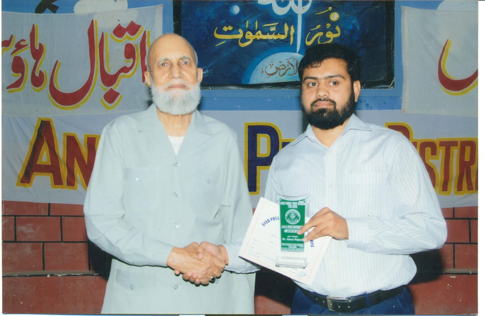
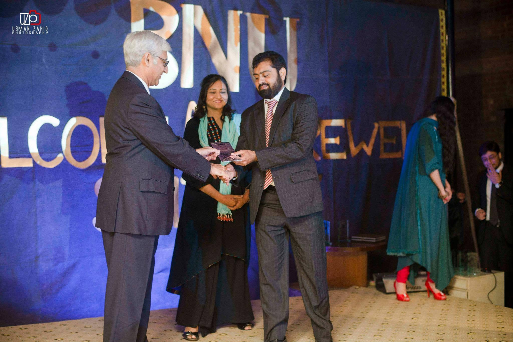
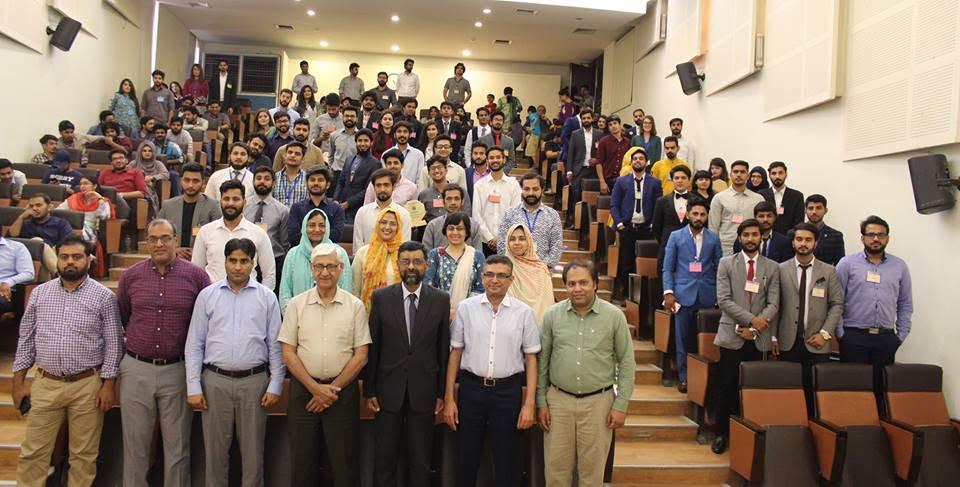
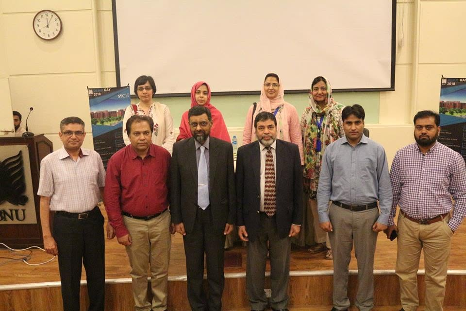
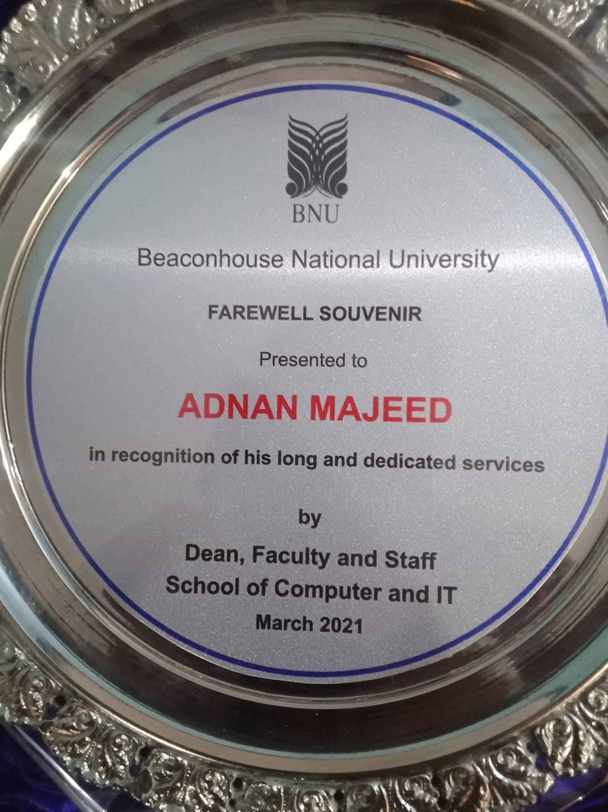
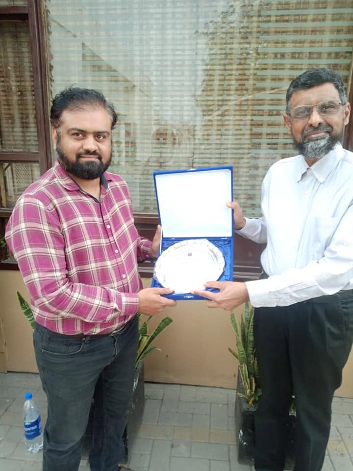

  # Adnan Majeed
**Lecturer | Data Scientist | Software Developer**  
Lahore, Pakistan

[LinkedIn](https://www.linkedin.com/in/adnan-majeed-55bb2b18/) · [GitHub](https://github.com/adnanmajeed82) · [Google Scholar](https://scholar.google.com/citations?user=KprstfQAAAAJ&hl=en) · [ORCID](https://orcid.org/0000-0002-9625-3648) · <a href="mailto:adnanmajeed82@gmail.com">✉ Contact Me</a>

## About
Computer Science professional focused on AI, machine learning, Generative AI, Python engineering, backend development, data science, and academic teaching. I build practical software, scalable APIs, and automation solutions.

## CV
[View CV](Adnan%20Majeed.pdf) · [Download CV](Adnan%20Majeed.pdf)

## Experience
- **Minhaj University Lahore** — Lecturer, Computer Science | Mar 2026–Oct 2026
- **Lahore Leads University** — Computer Science Teaching | 2023–2025
- **Hunar Foundation** — Technical Training | 2022–2023
- **Beaconhouse National University (BNU)** — Academic Teaching | 2012–2020

## Education
- **MPhil, Computer Science** — Hajvery University, 2016
- **MCS** — Virtual University of Pakistan, 2010–2013

## Skills
- **Programming:** Python, SQL, Java, JavaScript
- **AI & Data:** Machine Learning, Deep Learning, Generative AI, LLMs, AI Agents, Predictive Analytics
- **Frameworks:** Django, Django REST Framework, FastAPI, PyTorch, TensorFlow, scikit-learn, Hugging Face
- **Backend:** REST APIs, OpenAPI, JWT, Microservices
- **Databases & Tools:** PostgreSQL, SQLite, Git, GitHub, Docker, Postman
- **Cloud & DevOps:** Deployment, Containerization, CI/CD

## Selected Publications
1. **Django REST Framework Backend API Microservice Architecture for Enterprise Business Solution and Cloud Kafka Integrations** — *Spectrum of Engineering Sciences, 2026*
2. **AeroStrike: A Real-Time AI-Driven Framework for Wireless Network Threat Detection and Exploitation** — *Spectrum of Engineering Sciences, 2026*
3. **Design and Implementation of an Android-Based Gym Assistance Application Using Java and XML / Java Blockchain Mobile App** — *Spectrum of Engineering Sciences, 2025*
4. **Digital Image Restoration & Restoration of Burned Image & Documents Using Digital Image Processing: Possibilities and Limitations** — *Physical Education Journal of Health and Social Sciences, 2025*
5. **Efficient Data Storage and Retrieval: A Proportional Study of Pigeonhole Principle, Hashing Collisions, and Heap Priority Indexing** — *Spectrum of Engineering Sciences, 2025*

[View all publications and citations on Google Scholar](https://scholar.google.com/citations?user=KprstfQAAAAJ&hl=en)

## Featured Work
Areas: AI chatbots, intelligent assistants, business automation, Python applications, Django/FastAPI services, REST APIs, educational systems, and machine learning.

[Explore GitHub repositories](https://github.com/adnanmajeed82?tab=repositories)

## 🎓 FYP Projects – Minhaj University Lahore
Explore Final Year Projects (FYPs) developed and showcased by Computer Science students at Minhaj University Lahore.

- **Project Showcase:** Student software projects and demonstrations.
- **Technologies:** AI, Machine Learning, Web Development, Mobile Applications, and Software Engineering.
- **Academic Contribution:** Project supervision, technical mentoring, and software development guidance.
- **Alhamdulillah, 225+ projects displayed:** At Ibn-ul-Arabi Building, Computer Science Department. The showcase connected students with industry, software houses, freelancers, self-employed professionals, and business representatives.
- **[View FYP Projects Showcase on Facebook](https://www.facebook.com/share/p/1BYSA6G8ck/)**

## 🎤 Workshops & Seminars – Lahore Leads University
Conducted academic workshops and seminars focused on practical software development and emerging technologies.

- **Topic:** API Development in Python
- **University:** Lahore Leads University
- **Focus Areas:** Python Programming, REST APIs, Backend Development, and Software Engineering.
- **Academic Contribution:** Technical knowledge sharing, hands-on learning, and professional development.

🔗 **[View Seminar: API Development in Python](https://leads.edu.pk/seminar-on-api-development-in-python/)**

## 🏆 Achievements & Awards – Beaconhouse National University

Professional achievements, academic contributions, university events and recognition during my tenure at the School of Computer and IT, Beaconhouse National University, Lahore.

  

    
    
<strong>Professional Recognition</strong>

  

  

    
    
<strong>Academic Award Ceremony</strong>

  

  

    
    
<strong>Academic Community</strong>

  

  

    
    
<strong>Faculty Engagement</strong>

  

  

    
    
<strong>BNU Farewell Souvenir – March 2021</strong>

  

  

    
    
<strong>University Appreciation</strong>

  

## Teaching
Python · OOP · DBMS · Web Development · Django & REST APIs · Machine Learning · Deep Learning · Generative AI · Software Engineering · Cloud Computing

## QuibitX | Software Solutions
**Build. Automate. Scale.**

QuibitX creates practical digital solutions that help businesses work smarter and grow.

| Service | What We Build |
|---|---|
| **AI & GenAI** | AI chatbots, virtual assistants, LLM apps and AI agents |
| **Business Automation** | Workflow automation, smart reporting and customer support |
| **Web Applications** | Custom business systems, student portals and LMS platforms |
| **Backend & APIs** | Django, DRF, FastAPI, REST APIs and secure integrations |
| **Cloud & DevOps** | Docker, deployment, cloud integration and CI/CD |
| **Data & Machine Learning** | Data analytics, predictive models and visual dashboards |

**Connect with QuibitX:** [LinkedIn](https://www.linkedin.com/company/quibitx-lahore/home/?viewAsMember=true) · [Website](https://adnanmajeed82.github.io/)

## QuibitX
**Build · Automate · Scale**

QuibitX delivers AI chatbots, web applications, backend APIs, and business automation.

[QuibitX on LinkedIn](https://www.linkedin.com/company/quibitx-lahore/home/?viewAsMember=true) · [Portfolio](https://adnanmajeed82.github.io/)

## Contact
- **Email:** [adnanmajeed82@gmail.com](mailto:adnanmajeed82@gmail.com)
- **WhatsApp:** [+92 320 9422680](https://wa.me/923209422680)
- **LinkedIn:** [Adnan Majeed](https://www.linkedin.com/in/adnan-majeed-55bb2b18/)
- **GitHub:** [adnanmajeed82](https://github.com/adnanmajeed82)
- **Google Scholar:** [Research profile](https://scholar.google.com/citations?user=KprstfQAAAAJ&hl=en)
- **ORCID:** [0000-0002-9625-3648](https://orcid.org/0000-0002-9625-3648)

---

## Image Zoom / Popup

Click any award or portfolio image to enlarge it. Move the pointer outside the enlarged image to close the popup. You can also click the dark backdrop or press `Esc` to close it.

---

© Adnan Majeed · Lahore, Pakistan

 

 
